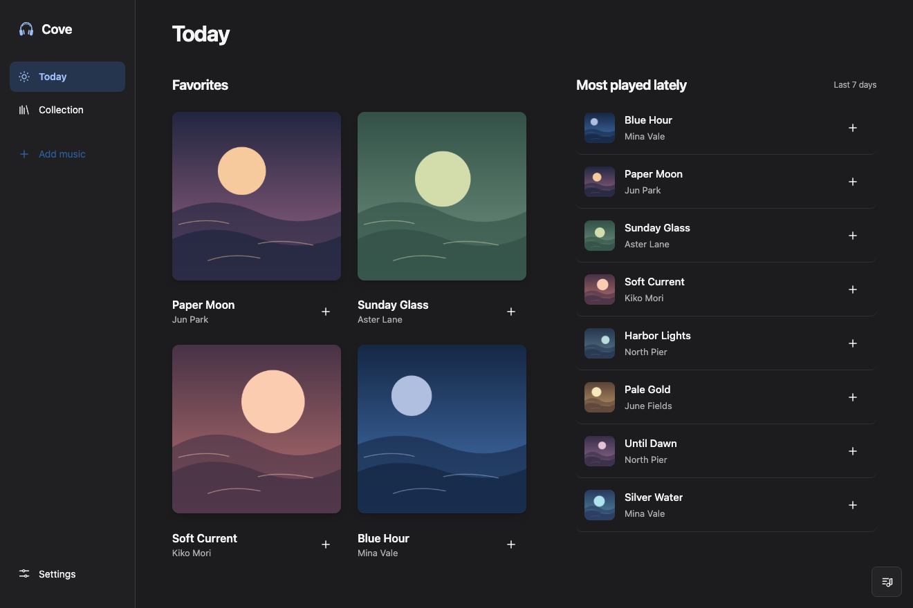

# Cove · オフライン音楽プレーヤー

[English](../../README.md) · [한국어](README.ko.md) · [简体中文](README.zh-CN.md) · 日本語

Coveは、手持ちの音楽を聴くためのオープンソースのオフラインプレーヤーです。FLAC、MP3、M4Aなどの音源を再生し、LRCの同期歌詞、プレイリスト、メモを自分のコンピューターに保存できます。再生にアカウントやインターネット接続は必要ありません。

## インストール

[GitHub Releases](https://github.com/woodychoi777/Cove/releases)からダウンロードし、公開されているSHA-256を照合してください。

- **Mac（Appleシリコン、macOS 13以降）**：DMGを開き、Coveを「アプリケーション」に移します。Appleの公証を受けていないため、開けない場合は[Appleの案内](https://support.apple.com/ja-jp/102445)をご確認ください。
- **Windows（10/11、x64プレビュー）**：セットアップEXEを実行するか、ポータブルZIPをすべて展開してCove.exeを開きます。署名は付いていません。GitHubのWindows環境でビルドと再生を確認しましたが、実機でのインストールとアンインストールの確認は残っています。
- **設定 → 外観 → 言語**で日本語を選び、Coveを終了して開き直します。

初回は新規ライブラリを作成するか、既存のライブラリを開きます。標準の保存先は「ミュージック/Cove」です。既存のライブラリは `soriseojae.sqlite` と `library` フォルダが入っている場所を選びます。

## 音楽を追加して聴く

1. サイドバーの **音楽を追加** からファイルやフォルダを選ぶか、ファイルをドロップします。標準では元ファイルを残してコピーします。**曲情報を確認してから追加** を選ぶと、曲名やアーティスト名を先に編集できます。
2. **Collection** で曲を選ぶと、その曲から表示順に再生します。下部のプレーヤーでキュー、シャッフル、リピートを操作できます。
3. 再生中の曲を開くと、歌詞、お気に入り、メモにアクセスできます。同期歌詞を取り込むには、音源と同じ名前のUTF-8の `.lrc` を一緒に置きます。

## 自動取り込み

**設定 → 自動取り込み** で専用フォルダを選び、プレビューを確認して開始します。Coveの起動中、サブフォルダも確認し、コピーが完了したファイルを取り込みます。同一ファイルは重複登録しません。**移動** を選ぶと、コピーと関連歌詞の検証後に元ファイルを削除します。監視フォルダはライブラリと別の場所にしてください。

## バックアップと更新

**設定 → 保存とエクスポート** で保存先を確認し、記録をJSONで書き出せます。音源とジャケットも含むバックアップには、Coveを終了してライブラリフォルダ全体をコピーします。更新前に編集中の内容を保存して終了し、Macではアプリを置き換え、Windowsでは新しいセットアップを実行してください。

[開発ガイド](DEVELOPMENT.md) · [MITライセンス](../../LICENSE)

Made by woodychoi777
